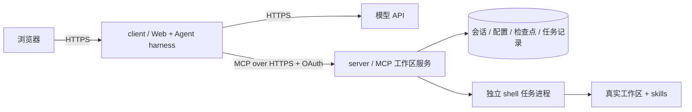

# MCP Agent

一个将 `skills-agent` 移植到浏览器的 Agent：Web harness 可以替换，工具、会话和真实工作区由独立的 MCP 服务提供。客户端与 MCP 服务分别启动，通过经过证书验证的 HTTPS 通信。



## 设计

- **无本地业务工具。** Harness 使用 `tools/list` 获取工具 schema，使用 `tools/call` 执行；默认向模型提供 `shell`、`job_status`、`job_cancel`。每轮模型请求前重新发现工具。客户端保留模型适配、工具路由和调度代码。
- **会话归远端。** 消息、模型配置、压缩摘要、执行检查点和任务结果保存于 MCP 服务。模型凭据可在浏览器设置，服务端返回浏览器时会隐藏密钥；环境变量提供的模型配置在首次执行时也写入远程会话。
- **shell + skill。** Skill 是服务端可读的 `SKILL.md` 和脚本，模型通过远程 shell 阅读和执行。默认提供工作区操作与任务检查两项 skill。
- **进程可替换。** 同一会话通过远程租约和版本号控制并发。工具调用先持久化，再派发；shell 根据稳定的 `operation_id` 去重。客户端退出后，远程 shell 继续执行，新 harness 可以接管已有任务。
- **真实工作区。** 浏览器提供文件浏览、文本预览、上传和下载。shell 的权限来自服务端执行账号，可使用该账号实际可访问的开发工具与环境。
- **OAuth 租户身份。** Authorization Code + PKCE、资源 audience 校验、短期授权码、可轮换 refresh token。租户由有效 access token 确定，不接受工具参数指定租户。

当前实现采用 [MCP 2026-07-28](https://modelcontextprotocol.io/specification/2026-07-28) 的 Streamable HTTP 请求模型，服务端返回 JSON，客户端可接收 JSON 或 SSE。这里的 Agent 会话属于应用数据，并非 MCP 传输会话。只声明实际实现的 tools 能力；未实现旧版初始化流程、resources、prompts 或订阅。

会话、租约和任务工具属于本项目的应用协议，MCP 提供它们的发现与调用通道。替换 harness 需要遵守这些接口，不能仅凭连接一个任意 MCP 服务就自动获得会话恢复能力。扩展服务端工具时，在 `tool_specs()` 中声明 schema、在 `call()` 中注册实现，并为面向模型的工具设置 `runtime=False`；无需在客户端新增对应的执行函数。

## 本地启动

需要 **Python 3.11+、OpenSSL，以及 macOS 或 Linux**。运行服务不需要第三方 Python 包；shell 任务监督使用 POSIX 进程接口。

```bash
git clone git@github.com:LvyuanW/mcp-agent.git
cd mcp-agent
python3 scripts/dev_setup.py --workspace /absolute/path/to/your/project \
  --tenant personal --username developer
```

`--workspace` 必须是已存在的目录。初始化会提示设置至少 12 位的登录密码，生成开发证书、两个独立的 `config.local.toml`，并注册租户工作区。密码也可通过 `MCP_AGENT_INIT_PASSWORD` 提供。配置和 `.local/` 不提交到 Git。

开发证书的 CA 位于 `.local/tls/ca.pem`。**需要自行将这个开发 CA 加入浏览器信任，或改用浏览器信任的证书**；脚本不会修改系统信任设置。客户端连接 MCP 时通过 `ca_file` 验证此 CA，不关闭 TLS 校验。

分别在两个终端启动：

```bash
# 终端一：MCP 服务
cd mcp-agent/server
python3 app.py
```

```bash
# 终端二：Web Agent
cd mcp-agent/client
python3 app.py
```

打开 **https://localhost:8443**，登录刚创建的开发者账号。在会话的模型设置中填写 provider、模型名、API Key，以及可选的兼容 API 地址，再发送任务。

支持 OpenAI Chat Completions / Responses、OpenAI 兼容接口和 Anthropic Messages。也可在启动客户端前配置 `OPENAI_API_KEY`、`OPENAI_MODEL`、`OPENAI_BASE_URL`，或对应的 `ANTHROPIC_*` 环境变量。程序不会自动读取 `.env`。不要把模型密钥配置到 shell 环境：任务子进程只继承明确允许的基础环境变量。

```bash
# 在仓库根目录检查两个服务
curl --cacert .local/tls/ca.pem https://localhost:9443/health
curl --cacert .local/tls/ca.pem https://localhost:8443/health
```

## 分别部署客户端与服务端

参考 [客户端配置](client/config.example.toml) 和 [服务端配置](server/config.example.toml)，可通过 `python3 app.py --config /absolute/path/config.toml` 指定配置。未指定时优先读取当前目录的 `config.local.toml`。相对文件路径相对于启动目录解析。

| 配置 | 用途 |
| --- | --- |
| 客户端 `public_url` | 浏览器实际使用的 HTTPS origin |
| 客户端 `mcp_url` | 远程工作区的完整 HTTPS `/mcp` 地址 |
| 客户端 `ca_file` | 私有 CA 文件；使用公开受信任证书时可不配置 |
| 客户端 `cookie_secret` / `MCP_AGENT_COOKIE_SECRET` | 至少 32 个字符；共享入口后的所有 harness 实例使用同一值 |
| 服务端 `public_url` | MCP / OAuth 服务对外 HTTPS origin |
| 服务端 `redirect_uris` | 精确登记允许的客户端 `/auth/callback` URL |
| 服务端 `data_dir` | 必须持久保存的会话、OAuth、任务与日志目录 |
| 两端 `cert_file` / `key_file` | 各自 HTTPS 证书与私钥 |

自定义部署可在服务端目录运行以下命令注册账号和工作区：

```bash
python3 app.py --config /absolute/path/server.toml --init \
  --tenant alice --username alice --workspace /srv/workspaces/alice
```

客户端不需要挂载工作区。浏览器在同一 HTTPS 入口下可以由不同 harness 处理请求；运行中的会话会定期尝试恢复，旧租约到期后新进程接管。使用另一个客户端域名时需要重新 OAuth 登录，仍会看到同一租户的远程会话。

## 执行权限与恢复边界

默认以 MCP 服务账号执行 shell，适用于个人或相互信任的部署。**OAuth 的租户数据隔离不等于操作系统权限隔离**：同一 OS 账号运行的 shell 可能读取该账号可访问的其他租户目录和服务数据。

对于互不信任的租户，应配置不同的非 root 系统账号、工作区权限及适合部署环境的进程隔离。服务支持在注册时指定 `--execution-user alice`：监督进程需以 root 运行，shell 和文件操作降权至指定用户，补充组被清空。服务程序、skills、配置和数据目录必须由受信任的管理账号拥有且不能由租户修改；工作区则由租户账号拥有。此路径有配置校验与测试，但尚未在本项目的非 root 验证环境中完成实际降权端到端验收。

会话数据库包含模型凭据，依赖服务数据目录权限保护，当前没有应用层加密或外部 secret manager。服务端已提供 OAuth 开发者登录，尚未接入外部企业身份系统。

- 已恢复：Web 进程更换、MCP HTTP 进程重启、shell 提交回执丢失、会话并发接管。
- 模型响应尚未提交时进程退出，会重新请求模型，可能产生重复推理费用。shell 执行去重不代表任意第三方工具都具备 exactly-once 语义。
- 独立 job supervisor 或主机被强制终止后的任务修复暂未实现；长驻守护进程也应由外部服务管理器管理。
- 运行中 worker 持有启动时的 access token。默认 8 小时有效；浏览器可刷新授权，超长运行在 token 过期后需要恢复会话。
- 多会话可共享工作区，但会话租约不会协调不同会话的文件修改。多人或多 Agent 协作仍需使用 Git worktree、分工或显式锁。
- 单次文本预览上限 512 KiB，上传 8 MiB，下载 16 MiB；更大的文件可通过远程 shell 处理。

## 验证与代码结构

```bash
python3 -m unittest discover -s tests -v
node --check client/static/app.js  # 可选；仅校验浏览器 JavaScript 语法
```

测试覆盖真实 HTTPS / OAuth 往返、工具发现与执行、跨租户访问、文件传输、会话版本和租约、取消、任务去重、进程退出后的远程任务存活、上下文压缩恢复。自动测试使用确定性模型替身，不需要模型凭据；实际模型调用需自行配置 provider。

| 目录 | 职责 |
| --- | --- |
| `client/app.py`、`client/static/` | HTTPS Web 服务、OAuth 回调、浏览器工作台 |
| `client/runtime.py`、`client/mcp.py` | 可替换 harness、MCP 客户端、远程工具注册 |
| `client/providers/`、`client/context.py` | 模型适配、流式响应、重试、上下文压缩 |
| `server/app.py`、`server/auth.py` | HTTPS MCP、工具授权、OAuth |
| `server/workspace.py`、`server/job_worker.py` | 持久化会话、租约、文件操作、独立 shell 任务 |
| `server/skills/` | 服务端 skill 文档及可执行脚本 |

模型适配与上下文管理沿用 `skills-agent`（基于 `9b21ca1`）的设计，工作区执行和状态管理改为 MCP。更详细的接口见 [CONTRACT.md](CONTRACT.md)。
